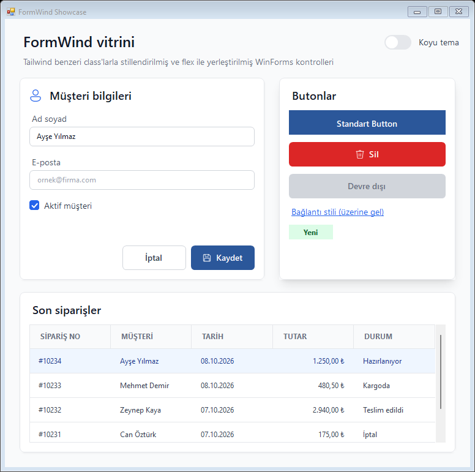
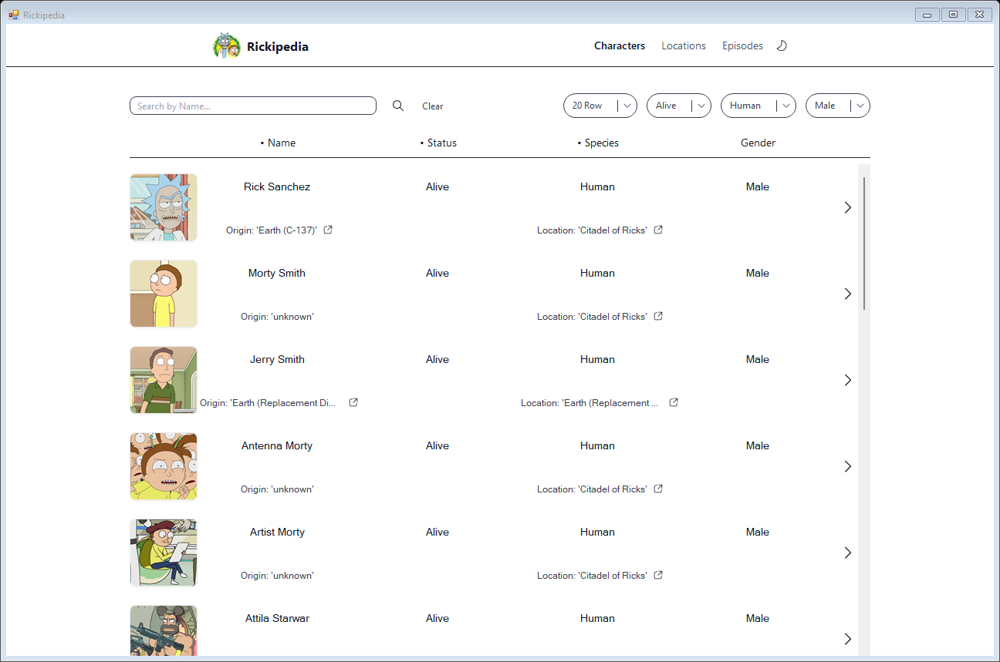
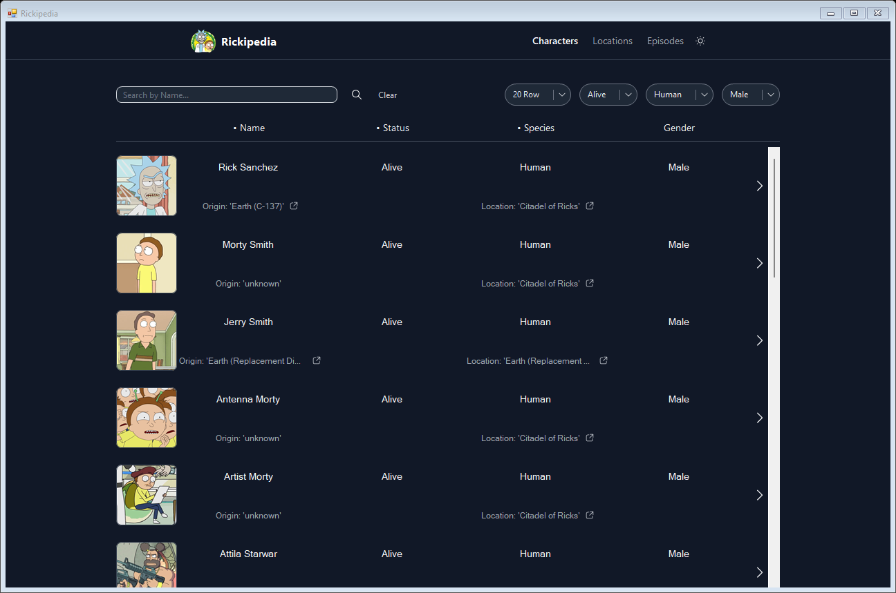

# FormWind

**Türkçe** | [English](README.en.md)

WinForms kontrolleri için Tailwind benzeri utility-class stil sistemi. Forma bir `TailwindProvider` bırakın; her kontrolün property penceresinde `Classes` alanı belirir:

```
btnSave  →  Classes: "bg-blue-600 text-white px-4 py-2 rounded-md font-bold hover:bg-blue-700"
```

- Hedefler: .NET Framework 4.7.2+ ve .NET 8+ (`net472`, `net8.0-windows`)
- Çekirdek paketin .NET dışında bağımlılığı yok (`net472` için yalnızca `System.Text.Json`)
- Durum varyantları: `hover:`, `focus:`, `active:`, `disabled:`, `checked:`, `dark:` ve birleşimleri (`dark:hover:`)
- Flex ve grid yerleşimi (`flex`, `gap-4`, `justify-between`, `flex-1`, `w-1/2`, `grid-cols-3`, `col-span-2`)
- Bileşen class'ları (`btn-primary`, `card`) ve JSON tema dosyası
- Yuvarlak köşeleri antialias çizen `TwButton`, `TwPanel`, `TwTextBox`
- Koyu temada native kaydırma çubukları ve ipuçları da koyulaşır
- WCAG kontrast denetimi (`TwContrast`) ve Windows Yüksek Karşıtlık desteği
- İsteğe bağlı Krypton Toolkit entegrasyonu (`FormWind.Krypton`)
- Gerçek uygulamalarda kaynak koduna dokunmadan deneme aracı (`tools/run-harness.ps1`)

| Açık tema | Koyu tema |
| --- | --- |
|  |  |

## Hızlı başlangıç

1. Paketi ekleyin (bkz. [Paketleme](#paketleme)) ya da `src/FormWind` projesine proje referansı verin.
2. `Program.Main` içinde, formlar açılmadan önce temayı yükleyin (dosya yoksa varsayılan tema kullanılır):

   ```csharp
   TwTheme.Current = TwTheme.LoadIfExists(Path.Combine(AppDomain.CurrentDomain.BaseDirectory, "tw.config.json"));
   ```

3. Toolbox'tan `TailwindProvider`'ı forma sürükleyin. Görünmüyorsa Toolbox → sağ tık → **Choose Items** → `FormWind.dll`.
4. Kontrolleri seçip `Classes on tailwindProvider1` alanını doldurun. Designer şunu üretir:

   ```csharp
   this.tailwindProvider1.SetClasses(this.btnSave, "btn-primary");
   ```

5. Koyu tema: `tailwindProvider1.DarkMode = true;`

## Class sözlüğü

| Kategori | Kalıp | Örnek | WinForms karşılığı |
| --- | --- | --- | --- |
| Arka plan | `bg-{renk}-{ton}`, `bg-[#hex]` | `bg-blue-600`, `bg-white` | `BackColor` |
| Yazı rengi | `text-{renk}-{ton}` | `text-gray-900` | `ForeColor` |
| Yazı boyutu | `text-xs … text-4xl` | `text-sm` = 14 px | `Font` (px × 0,75 = pt) |
| Yazı stili | `font-thin` … `font-black`, `font-sans`, `font-mono`, `italic`, `underline` | `font-semibold` | `Font` (bkz. [Font kalınlıkları](#font-kalınlıkları)) |
| İç boşluk | `p`, `px`, `py`, `pt`, `pr`, `pb`, `pl` + `-{n}` / `-px` / `-[12px]` | `px-4` = 16 px | `Padding` |
| Dış boşluk | `m`, `mx`, `my`, `mt`, `mr`, `mb`, `ml` + `-{n}` | `mt-2` = 8 px | `Margin` (layout panellerinde) |
| Boyut | `w-{n}`, `h-{n}` | `h-10` = 40 px | `Width`, `Height` |
| Kenarlık | `border`, `border-{0,2,4,8}`, `border-{renk}-{ton}` | `border border-gray-300` | Çizim |
| Köşe | `rounded`, `rounded-{none,sm,md,lg,xl,2xl,3xl,full}`, `rounded-[10px]` | `rounded-md` = 6 px | `Region` veya owner-draw |
| Hizalama | `text-left`, `text-center`, `text-right` | | `TextAlign` |
| Diğer | `cursor-pointer`, `cursor-text`, `hidden`, `visible`, `truncate` | | `Cursor`, `Visible`, `AutoEllipsis` |

- Boşluk birimi 4 px'tir (`spacingUnit` ile değiştirilebilir). Sayılar her kültürde nokta ile yazılır: `p-0.5`.
- Palet: Tailwind v3'ün 22 rengi × 11 tonu (50–950), ayrıca `white`, `black`, `transparent`.
- Aynı varyant içinde sonra gelen class kazanır: `p-2 px-4` → dikey 8 px, yatay 16 px.
- Tanınmayan class'lar `TailwindProvider.UnknownClasses` olayına (dinleyici yoksa Debug çıktısına) bildirilir.
- CSS'te padding kutuyu büyütür; WinForms'ta boyutu sabit (`AutoSize` kapalı) bir buton ya da etikette ise içeriği daraltır. Bu kontrollerde padding, yazı tek satıra sığacak kadar kısılır (örn. 25 px yüksekliğindeki bir butona `btn` verildiğinde `py-2` küçülür). Kontrol büyüyünce, fontu ya da metni değişince yeniden hesaplanır ve yer varsa tam değere döner.
- `hidden` kaldırıldığında FormWind'in gizlediği kontrol yeniden görünür olur.
- Class rengi ebeveynden kalıtılan renkle aynı olsa da kontrole açıkça atanır; ebeveynin rengi sonradan değişince class rengi değişmez.
- Class'lar kaldırıldığında (`SetClasses(control, "")`) renk, font, padding, margin, imleç, görünürlük, köşe ve ToolStrip renderer'ı class'lardan önceki değerlerine döner. Boyutlar (`w-*`, `h-*`) geri alınmaz; yerleşim kontrolü sonradan yeniden boyutlandırmış olabilir.

### Uygulama kodunun atadığı renkler

Class'lar uygulandıktan sonra uygulama kodu bir kontrolün `BackColor` ya da `ForeColor` değerini değiştirirse (örn. bir durum göstergesini yeşile boyamak), FormWind o renk kanalını uygulamaya bırakır: `hover:`, `dark:` ve diğer varyantlar o rengi ezmez. Diğer kanal FormWind'de kalır.

```csharp
tw.SetClasses(lblStatus, "bg-white text-gray-700 dark:bg-gray-800 dark:text-gray-200");
lblStatus.BackColor = Color.LightGreen;   // koyu temaya geçince de yeşil kalır; yazı rengi class'lardan gelir
tw.SetClasses(lblStatus, "bg-red-600 text-white");   // yeni class'lar: arka plan yeniden FormWind'in
```

- Ebeveynden kalıtılan renk değişimleri (örn. form koyu temaya geçti) uygulamanın ataması sayılmaz.
- Kanalı geri almak için farklı class'lar atanmalıdır; `Refresh(control)` yetmez.
- Uygulama yalnızca zemini değiştirip yazı rengini class'lara bırakırsa koyu temada okunmayan bir çift (açık yazı, açık zemin) çıkabilir. [Kontrast denetimi](#kontrast-denetimi) bunu raporlar.

## Yerleşim (flex ve grid)

`flex` ya da `grid` class'ı verilen bir **`TwPanel`** çocuklarını kendisi yerleştirir; çocukların `Location`'ı, `Dock` ve `Anchor` değerleri yok sayılır. Standart `Panel` ve `Form`'un yerleşim motoru değiştirilemediğinden flex/grid yalnızca `TwPanel` (ya da `ITwLayoutHost` uygulayan bir konteyner) üzerinde çalışır.

```csharp
// Kart: dikey dizilim, öğeler genişliği doldurur
this.tailwindProvider1.SetClasses(this.pnlCard, "card flex flex-col gap-1");
// Buton satırı: sağa yaslı, 8 px aralıklı
this.tailwindProvider1.SetClasses(this.pnlActions, "flex justify-end gap-2");
// Boşluk doldurucu: kalan alanı kaplar ve buton satırını alta iter
this.tailwindProvider1.SetClasses(this.pnlSpacer, "flex-1");
```

| Konteyner (TwPanel) | Öğe (çocuk kontrol) |
| --- | --- |
| `flex`, `grid`, `block` | `flex-1`, `flex-auto`, `flex-initial`, `flex-none` |
| `flex-row`, `flex-col`, `flex-wrap`, `flex-nowrap` | `grow`, `grow-0`, `shrink`, `shrink-0` |
| `gap-{n}`, `gap-x-{n}`, `gap-y-{n}` | `basis-{n}`, `basis-1/2`, `basis-full`, `basis-auto` |
| `justify-start/end/center/between/around/evenly` | `w-1/2`, `w-full`, `h-full` (oranlar konteynere göre) |
| `items-start/end/center/stretch` | `min-w-{n}`, `max-w-{n}`, `max-w-md` …, `min-h-{n}`, `max-h-{n}` |
| `grid-cols-{1–12}` | `self-start/end/center/stretch`, `col-span-{1–12}`, `col-span-full`, `m-*` |

CSS'ten farklar:
- Öğelerin "doğal" boyutu Designer'daki `Size`'dır (AutoSize kontrollerde tercih edilen boyut). Boyutu belirtilmemiş öğeler doğal boyutlarının altına küçülmez.
- Öğe aralığı yalnızca `m-*` class'larından gelir; WinForms'un varsayılan 3 px `Margin`'i kullanılmaz.
- Varsayılan `items-stretch`: satırdaki öğeler konteyner yüksekliğine, sütundaki öğeler genişliğine uzar.
- Grid satır yükseklikleri içerikten belirlenir; `grid-rows-*`, `row-span-*`, `margin: auto` ve `order-*` yok.
- Öğeler satırın çapraz boyutunu aşmaz (CSS'te taşabilir; WinForms'ta taşan kısım kesilip kaybolurdu). Daralan Label'larda `truncate` "…" gösterir.
- `TwPanel`'in içeriği kenarlığın içinde başlar (CSS kutu modeli); `AutoScroll` panelde genişlik görünen alandan alınır ve dikey kaydırma çubuğunun yeri önceden ayrılır.
- `AutoSize = true` olan flex `TwPanel` içeriğine göre boyutlanır (grid için henüz yok).
- Responsive varyantlar (`sm:`, `md:` …): bkz. [Animasyonlar ve responsive varyantlar](#animasyonlar-ve-responsive-varyantlar).

## Font kalınlıkları

`font-thin` (100), `font-extralight` (200), `font-light` (300), `font-normal` (400), `font-medium` (500), `font-semibold` (600), `font-bold` (700), `font-extrabold` (800), `font-black` (900).

WinForms yalnızca normal ve kalın stilleri bilir; ara kalınlıklar Windows'ta **ayrı font aileleri** olarak kuruludur. FormWind kalınlığı bu ailelere CSS'in eşleme kuralıyla çözer:

| Class | Segoe UI'da kullanılan |
| --- | --- |
| `font-thin`, `font-extralight`, `font-light` | Segoe UI Light |
| `font-normal`, `font-medium` | Segoe UI |
| `font-semibold` | Segoe UI Semibold |
| `font-bold` | Segoe UI + kalın stil |
| `font-extrabold`, `font-black` | Segoe UI Black |

Başka bir font için ağırlık aileleri tema dosyasında tanımlanır; kurulu olmayan aile atlanır ve en yakın kurulu kalınlık seçilir:

```jsonc
"fontWeights": { "Inter": { "300": "Inter Light", "600": "Inter SemiBold" } }
```

## İkonlar

Windows'la gelen ikon fontu kullanılır: Windows 11'de **Segoe Fluent Icons**, Windows 10'da **Segoe MDL2 Assets** (Windows 7/8'de ikon çizilmez).

- **`TwIcon`**: tek başına ikon. `IconName` property'si Designer'da açılır listeden seçilir. Renk `text-*`, boyut font boyutuyla verilir: `text-xl` = 20×20 px. AutoSize varsayılan olarak açıktır.
- **`TwButton.IconName`**: metnin yanında ikon. `IconPosition` (Left/Right) ve `IconSpacing` (varsayılan 8 px) ayarlanabilir.

```csharp
this.icoCustomer.IconName = "user";
this.tailwindProvider1.SetClasses(this.icoCustomer, "text-xl text-blue-600 dark:text-blue-400");
this.btnSave.IconName = "save";
```

Yerleşik adlar: `arrow-down`, `arrow-left`, `arrow-right`, `arrow-up`, `attach`, `bell`, `calculator`, `calendar`, `camera`, `cart`, `check`, `chevron-down`, `chevron-left`, `chevron-right`, `chevron-up`, `clock`, `copy`, `cut`, `download`, `edit`, `error`, `eye`, `eye-off`, `file`, `filter`, `flag`, `folder`, `folder-open`, `fullscreen`, `globe`, `grid`, `heart`, `heart-filled`, `help`, `history`, `home`, `image`, `info`, `key`, `link`, `list`, `location`, `lock`, `mail`, `map-pin`, `menu`, `minus`, `more`, `paste`, `phone`, `pin`, `plus`, `power`, `print`, `redo`, `refresh`, `save`, `search`, `send`, `settings`, `share`, `shield`, `sort`, `star`, `star-filled`, `sync`, `tag`, `trash`, `undo`, `unlock`, `upload`, `user`, `users`, `warning`, `x`, `zoom-in`, `zoom-out`.

Fontun herhangi bir glyph'i kod noktasıyla da kullanılabilir (`IconName = "#E8A5"`). Ek adlar ve farklı bir ikon fontu tema dosyasından verilir:

```jsonc
"iconFont": "Segoe Fluent Icons",
"icons": { "invoice": "E8A5" }
```

Glyph'ler font metriklerine güvenilmeden, gerçek mürekkep sınırlarına göre ortalanarak çizilir (ikon fontlarının satır yüksekliği glyph boyutuyla uyuşmaz).

### SVG ikonlar

Lucide, Heroicons, Tabler gibi tek renkli SVG setleri de kullanılabilir. `icons` değeri bir `.svg` yolu (tema dosyasına göre) ya da doğrudan `<svg>` metni olabilir; kodda `TwTheme.SetSvgIcon(ad, svg)`:

```jsonc
"icons": {
  "invoice": "E8A5",                         // ikon fontu glifi
  "package": "Assets/icons/package.svg",     // dosya
  "dot": "<svg viewBox='0 0 24 24'><circle cx='12' cy='12' r='4'/></svg>"
}
```

SVG ikon aynı adlı glifi ezer, böylece yerleşik ikonlar (`check`, `chevron-down` …) tüm kontrollerde (`TwButton`, `TwSelect`, takvim, grid) tek tek değiştirilebilir. Renk her zaman çizildiği yerin metin rengidir (`currentColor` gibi). Desteklenenler: `path` (tüm komutlar, yaylar dahil), `circle`, `ellipse`, `rect` (`rx`), `line`, `polyline`, `polygon`, `g`; `fill`, `stroke`, `stroke-width`, `stroke-linecap`, `stroke-linejoin`. Gradient, maske, metin ve CSS desteklenmez.

## Kenarlık, gölge ve focus halkası

| Class | Etki |
| --- | --- |
| `border-t`, `border-b-2`, `border-x`, `border-y` | Kenar bazlı kenarlık (köşesiz çizilir) |
| `shadow-sm`, `shadow`, `shadow-md`, `shadow-lg`, `shadow-xl`, `shadow-2xl`, `shadow-none` | Tailwind v3 gölge katmanları (bulanık) |
| `shadow-{renk}`, `shadow-blue-500/50` | Renkli gölge |
| `ring`, `ring-0/1/2/4/8`, `ring-{renk}`, `ring-offset-2`, `ring-offset-{renk}` | Halka; genelde `focus:ring-2 focus:ring-blue-500/30` |
| `bg-black/50`, `text-white/75` … | Saydamlık: tüm renk class'larında `/0–100` |

Gölge ve halka kontrolün **ebeveyninde** çizilir (kontroller kendi sınırlarının dışına çizemez); Form, Panel ve TwPanel ebeveynlerinde çalışır. Bu sayede `TextBox` gibi native kontrollerin de focus halkası olabilir.

## Gradient

`bg-gradient-to-{r,l,t,b,tr,tl,br,bl} from-{renk} via-{renk} to-{renk}` — `TwPanel`, `TwButton` ve standart `Panel`'de çizilir. Eksik uç diğer ucun saydam halidir.

## Etkileşim

- **`transition`** (`transition-colors`, `duration-75` … `duration-1000`, `duration-[250ms]`): arka plan ve metin rengi değişimleri yumuşak geçişle (ease-out, varsayılan 150 ms) uygulanır.
- **`hover:` / `active:`**: yalnızca bu varyantları olan kontroller fare girip çıkınca yeniden stillenir; diğerlerinde fare hareketi stil uygulamasını tetiklemez. Class'lar imleç zaten kontrolün üzerindeyken atanırsa (örn. tıklayınca class'ı değişen bir buton) hover durumu hemen uygulanır.
- **`group` / `group-hover:`**: `group` class'lı konteynerin üzerine gelindiğinde içindeki kontrollerin `group-hover:` varyantları uygulanır. Hover'a tepki veren konteynerler, imleç doğrudan bir çocuk kontrolün üzerinden girse de hover sayılır.
- **Placeholder**: `TwTextBox.PlaceholderText`; renk `placeholder:text-gray-400`.
- **`focus-visible:`**: yalnızca odak klavyeyle (Tab, oklar) geldiğinde uygulanır; fareyle tıklanan kontrolde uygulanmaz (`focus-visible:ring-2 focus-visible:ring-blue-500/40`). Owner-draw kontrollerin (`TwButton`, `TwTabStrip`, `TwDataList`, `TwCalendar`, `TwSlider`) odak halkaları da aynı kuralla çizilir. Son girişin türü `TwFocusVisible.LastInputWasKeyboard` ile okunabilir.

## CheckBox, Radio, Switch

`TwCheckBox`, `TwRadioButton`, `TwSwitch` owner-draw çizilir. Seçili renk `accent-*`, seçili değilken dolgu `fill-*`, kutu kenarlığı `border-*`, köşe `rounded-*`, metin `text-*`. `TwSwitch` (44×24 px) düğmesi 150 ms içinde kayar.

## Menü ve araç çubukları

MenuStrip, ToolStrip, StatusStrip ve ContextMenuStrip için tema renderer'ı. Temel class'lar şeride, `menu:` açılan menülere, `item:` öğelere uygulanır:

```csharp
SetClasses(menuStrip1, "bg-white text-gray-700 border-b menu:bg-white menu:border-gray-200 item:hover:bg-gray-100 item:rounded-md divide-gray-200 dark:bg-gray-900 dark:text-gray-200");
```

- `item:hover:`, ayırıcı (`divide-*`) ve menü kenarlığı (`menu:border-*`) verilmezse varsayılanlar açık şerit içindir. Şeridin zemini koyuysa bu renkler şeridin kendi zemin ve yazı renginden türetilir; böylece koyu şeritte hover kutusunda yazı kaybolmaz.
- Öğelere elle atanmış açılır menüler (`menuItem.DropDown = contextMenuStrip1`) WinForms'ta sahibinin renderer'ını devralmaz. FormWind bu menülere şeridin renderer'ını verir (iç içe menüler dahil). Kendi renderer'ı atanmış ya da kendi class'ları olan menülere dokunulmaz. Şeride sonradan atanan bir menü, şerit bir sonraki uygulanışında (örn. tema değişimi) renk alır.
- Renkler değişmedikçe renderer yeniden atanmaz (atama şeridi yeniden yerleştirir). Class'lar kaldırılınca şeridin özgün renderer'ı geri yüklenir.

## Başlık çubuğu

Form'a class verildiğinde koyu tema açıkken başlık çubuğu otomatik koyulaşır (Windows 10 20H1+). Windows 11'de `caption:bg-*`, `caption:text-*`, `caption:border-*` ile renklendirilir.

`backdrop-mica`, `backdrop-acrylic`, `backdrop-tabbed` (Mica Alt) ve `backdrop-none` Windows 11 22H2+ sistem zeminini seçer. Zemin başlık çubuğunda ve pencere çerçevesinde görünür; WinForms istemci alanını opak çizdiği için form içinde görünmez. `caption:bg-*` verilirse başlık rengi zeminin önüne geçer.

## Koyu tema: kaydırma çubukları ve ipuçları

`DarkMode = true` iken FormWind'in çizmediği native parçalar da Windows'un koyu temasına geçer:

| Özellik (varsayılan açık) | Etki |
| --- | --- |
| `TailwindProvider.DarkScrollbars` | Panel, TextBox, ListBox, TreeView, ListView ve DataGridView kaydırma çubukları |
| `TailwindProvider.DarkToolTips` | Native ipucu pencereleri: `ToolTip` bileşenleri, ToolStrip öğe ipuçları, ListView/TreeView ipuçları |

- İpuçları uygulamanın kendi bileşenlerine ait olduğundan `DarkToolTips` iş parçacığı geneline etki eder: koyu temada en az bir provider varsa o iş parçacığının ipuçları koyudur. Tema değişince açık ipucu pencereleri de güncellenir.
- İkisi de Windows Gezgini'nin kullandığı belgelenmemiş `DarkMode_Explorer` temasını kullanır (Windows 10 1809+); desteklenmeyen sistemlerde etkisizdir, sorun olursa kapatılabilir.
- Class'larla stillenen ipucu için `TwToolTip` kullanılabilir.

## DataGridView

DataGridView'un bölümleri **parça önekleriyle** stillenir; durum önekleriyle birleştirilebilir (`dark:header:bg-gray-900`, `row:hover:bg-gray-50`). Hazır `table` bileşeni tek class'la açık ve koyu temalı bir tablo verir:

```csharp
this.tailwindProvider1.SetClasses(this.gridOrders, "table");
```

| Önek | Hedef | Desteklenen class'lar |
| --- | --- | --- |
| (yok) | Kontrol alanı ve tüm hücreler | `bg-*`, `text-*`, font, `border`, `divide-x`, `divide-y`, `divide-{renk}` (ızgara çizgileri) |
| `cell:` | `DefaultCellStyle` | renk, font, `px-*`/`py-*`, `text-left/center/right`, `whitespace-nowrap` |
| `alt:` | `AlternatingRowsDefaultCellStyle` | renk, font |
| `selected:` | Seçim renkleri | `bg-*`, `text-*` |
| `header:` | Kolon başlıkları | renk, font, padding, hizalama, `h-*`, `border-0`, `whitespace-nowrap` |
| `row:` | Satırlar | `h-*` (satır yüksekliği), `row:hover:bg-*` / `row:hover:text-*` (satır hover'ı) |
| `row-header:` | Satır başlıkları | `hidden`, renk |

- Başlık renkleri verildiğinde `EnableHeadersVisualStyles` kapatılır (Windows teması başlık renklerini yok sayar).
- Class'lar kaldırıldığında grid'in orijinal stillerine dönülür.
- Kaydırma çubukları koyu temada Windows'un koyu çubuklarına geçer (`TailwindProvider.DarkScrollbars`, varsayılan açık).
- Parça önekleri DataGridView dışındaki kontrollerde yok sayılır.
- `row:h-*`, `VirtualMode` ya da `DataSource` kullanan grid'lerde `RowHeightInfoNeeded` olayıyla verilir: satırlar paylaşımdan çıkarılmaz, kaydırma konumu ve seçili hücre korunur (17.000 satırda ~12 ms; satır satır atamada ~17 sn). Bağlı olmayan grid'lerde yalnızca yüksekliği farklı satırlar güncellenir.
- Grid'in zemini (`BackgroundColor`) saydamlığı desteklemez; saydam bir `bg-*` zeminde özgün renge düşer (hücrelere yine uygulanır).
- Satır eklenince grid yalnızca boş tablo ya da yükleniyor görünümü değişiyorsa yeniden çizilir.
- **Kendi çizen grid'ler:** hücreleri kendisi çizen grid'ler (örn. Git Extensions'ın commit listesi) hücre stillerini yok sayar ve yapısal özelliklere bağımlı olabilir. `divide-x` / `divide-y` `CellBorderStyle`'ı, `row:h-*` satır yüksekliğini değiştirir; böyle bir grid `CellBorderStyle.None` ya da kendi satır yüksekliğini varsayıyorsa bu class'ları kullanmayın. Git Extensions'ın commit listesi `SingleHorizontal` kenarlıkla kaydırırken kilitlenir; FormWind olmadan da aynısı olur.

### Kolon class'ları

Her kolonun Properties penceresinde **ColumnClasses on tailwindProvider1** özelliği vardır (kodda `SetColumnClasses`). Temel class'lar kolonun hücrelerine, `header:` başlığa uygulanır; `w-32`, `min-w-20`, `flex-1` (Fill ağırlığı) ve `hidden` kolonun kendisini etkiler. Font boyutu verilmezse grid'in fontu korunur.

```csharp
tw.SetColumnClasses(colTotal, "text-right font-semibold w-28 header:text-right");
tw.SetColumnClasses(colName, "flex-1 min-w-40");
```

### Hücre tipleri

| Kolon | Değer | Ayarlar |
| --- | --- | --- |
| `TwBadgeColumn` | Metin; değere göre renkli rozet | `Variants = "Alive: bg-green-100 text-green-800 dark:bg-green-900 dark:text-green-100; Dead: bg-red-100 text-red-800; *: bg-gray-100 text-gray-700"` |
| `TwAvatarColumn` | `Image` (yoksa `Placeholder` rengi) | `AvatarSize`, `Radius` |
| `TwIconColumn` | İkon adı (`check`, `#E710`) | Renk hücrenin metin rengi |
| `TwProgressColumn` | 0–`Maximum` sayı | `ShowText`, `BarColor`, `TrackColor`, `DarkTrackColor` |
| `TwCheckColumn` | `bool` / `CheckState` | Yuvarlak köşeli kutu, `AccentColor`, `BoxSize`; `ThreeState` belirsiz durumu çizgiyle gösterir |
| `TwButtonColumn` | Metin (ya da `Text` + `UseColumnTextForButtonValue`) | `Classes = "rounded-md bg-red-600 text-white hover:bg-red-700"`; tıklama `CellContentClick` ile |

Hücre tipleri koyu temayı grid'in sağlayıcısından öğrenir; `dark:` varyantları ayrıca ayar gerektirmez.

### Satır kuralları

```csharp
tw.SetRowClasses(gridOrders, row =>
    row.Cells["colStatus"].Value as string == "İptal" ? "text-gray-400 dark:text-gray-500" : null);
```

Kural her satır için class döndürür (`null` = değişiklik yok); `CellFormatting` sırasında uygulanır, veri değişince kendiliğinden güncellenir. `SetRowClasses(grid, null)` kuralı kaldırır.

### Sıralama, boş tablo ve yükleniyor durumu

Class verilmiş grid'lerde başlıktaki sıralama oku tema ikonuyla (`arrow-up` / `arrow-down`) ve `accent-*` rengiyle çizilir. `List<T>` ya da düz `BindingList<T>` ile bağlanan grid başlığa tıklanınca sıralamaz; `TwSortableBindingList<T>` ile `SortMode = Automatic` kolonlar sıralanır (metinler geçerli kültürle, Türkçe harf sırası dahil; eşit değerler yerini korur):

```csharp
gridOrders.DataSource = new TwSortableBindingList<Order>(orders);
TwGrid.SetEmptyText(gridOrders, "Kayıt bulunamadı");   // satır yokken ortada ikon + metin (TwGrid.SetEmptyIcon)
TwGrid.SetLoading(gridOrders, true);                   // satır yoksa iskelet satırlar, varsa soluk katman + "Yükleniyor…"
```

Hücre düzenlenirken açılan TextBox/ComboBox kenarlıksız ve hücre renkleriyle gösterilir; koyu temada kaydırma çubukları da koyulaşır.

### Süzme, kolon seçimi ve sayfalama

```csharp
TwGrid.EnableFilterMenu(gridOrders);     // başlıkta süzme düğmesi: kolonun değerleri onay kutularıyla
TwGrid.EnableColumnChooser(gridOrders);  // başlığa sağ tık: kolonları göster/gizle
```

- Süzme menüsü veri kaynağı `ITwFilterableList` olan grid'lerde (`TwSortableBindingList<T>`) ve `DataPropertyName`'i olan kolonlarda görünür. Süzülen kolonun düğmesi `accent-*` renginde çizilir. Kodla: `list.SetColumnFilter("City", new[] { "İzmir" })`, `ClearFilters()`.
- Sıralamalar üst üste uygulanır (önce ada, sonra tarihe göre sıralanan listede aynı tarihliler ada göre kalır); süzme sıralamayı korur, eklenen ve silinen satırlar tüm listeye yansır.
- Kolon menüsünde son görünen kolon gizlenemez.

`TwPager` sayfalama düğmeleri çizer (‹ 1 … 9 10 11 … 20 ›); veriyi sayfaya göre siz bağlarsınız:

```csharp
pager.TotalItems = orders.Count;
pager.PageSize = 20;
pager.PageChanged += (s, e) => grid.DataSource = orders.Skip(pager.FirstItemIndex).Take(pager.PageSize).ToList();
tw.SetClasses(pager, "text-gray-700 selected:bg-blue-600 selected:text-white item:hover:bg-gray-100");
```

### Varyantların uygulanma sırası

Sonraki, öncekini ezer: temel → `dark:` → `checked:` → `focus:` → `focus-visible:` → `group-hover:` → `hover:` → `dark:hover:` → `active:` → `disabled:` → `invalid:` → `sm:` → `md:` → `lg:` → `xl:` → `2xl:` → `forced-colors:` (Tailwind'deki gibi genişlik varyantları en sonda).
Kontrol devre dışıyken `focus`, `hover` ve `active` uygulanmaz.

## Tema dosyası (`tw.config.json`)

```jsonc
{
  "fontFamily": "Segoe UI",
  "spacingUnit": 4,
  "colors": {
    "brand": { "500": "#2b579a", "600": "#234a85" },   // bg-brand-500
    "surface": "#f3f6fb"                                  // bg-surface
  },
  "components": {
    "btn-primary": "btn bg-brand-500 text-white hover:bg-brand-600"
  }
}
```

`fontFamily` virgülle ayrılmış bir yığın olabilir (`"Inter, Segoe UI"`): kurulu ya da kayıtlı ilk aile kullanılır. Uygulamayla dağıtılan fontlar `"fonts": ["Assets/fonts/Inter-Regular.ttf", "Assets/fonts/Inter-SemiBold.ttf"]` ile kurulum gerektirmeden kaydedilir (yol tema dosyasına göredir, bulunamayan dosya atlanır); kodda `TwFonts.Register(path)`. Fontlar hem GDI+ (`PrivateFontCollection`) hem GDI (`AddFontResourceEx`, süreç içi) tarafına kaydedildiğinden `TextRenderer` ile çizilen standart kontrollerde de çalışır. Font dosyalarının lisansını (örn. SIL OFL) uygulamayla birlikte dağıtın.

Dosya varsayılan palet ve bileşenlerin üzerine eklenir. Varsayılan bileşenler: `btn`, `btn-primary`, `btn-ghost`, `btn-danger`, `card`, `input`, `table` (bkz. `TwTheme.DefaultComponents`). Designer tema dosyasını okumadığından tasarım zamanı önizlemesi varsayılanlarla yapılır.

## Örnek: Rickipedia

`samples/Rickipedia`, [The Rick and Morty API](https://rickandmortyapi.com) verisiyle bir karakter listesi sayfasıdır: ada göre arama, durum/tür/cinsiyet filtreleri, satır sayısı seçimi, koyu tema ve satıra tıklayınca ayrıntı penceresi. Sayfanın tamamı FormWind class'larıyla stillenmiş standart WinForms kontrolleri ve `Tw*` kontrolleridir; sayfa bileşenleri `tw.config.json` içindedir.

| Açık tema | Koyu tema |
| --- | --- |
|  |  |

```bash
samples/Rickipedia/bin/Debug/net472/Rickipedia.exe --snapshot sayfa.png --dark --menu --details
```

## Kontroller

| Kontrol | Ne zaman |
| --- | --- |
| `TwPictureBox` | Pürüzsüz yuvarlak köşeli resim (`rounded-lg`, `rounded-full` avatar); `object-cover` / `object-contain` / `object-fill`. |
| `TwSelect` | Stillenebilir açılır liste (native ComboBox'ın yerine): kutu temel class'larla, menü `menu:` / `item:` ile. Genişlik varsayılan olarak seçili öğeye göredir (`SizeToSelection`). Harf yazmak o harflerle başlayan öğeyi seçer; `Searchable = true` menünün üstüne öğeleri süzen bir arama kutusu ekler (büyük/küçük harf, aksan ve ı/i farkı gözetilmez). |
| `TwIcon` | Tek başına ikon (bkz. [İkonlar](#i̇konlar)). |
| `TwCheckBox`, `TwRadioButton`, `TwSwitch` | Bkz. [CheckBox, Radio, Switch](#checkbox-radio-switch). |
| Standart kontroller | Renk, yazı ve boşluk her kontrolde çalışır. Köşe `Region` ile kırpılır (antialias yok), kenarlık `Paint` olayında çizilir. `TextBox`'ta (`TextBoxBase`) native kenarlık kapatılır; `border-*` ve `rounded-*` ebeveynde, kontrolün 3 px dışına zemin rengiyle doldurulmuş bir çerçeve olarak çizilir (çerçeve kontrolün sınırlarından taşar, yerleşimde pay bırakın). `DropDownList` modundaki `ComboBox`'ın kapalı kutusu (zemin, kenarlık, köşe, metin, ok) FormWind tarafından çizilir; açılır liste native kalır. Düzenlenebilir `ComboBox`'ta ve diğer native kontrollerde (`ListBox` …) köşe ve kenarlık uygulanmaz; `TwSelect`, `TwListBox` kullanın. |
| `TwButton` | Pürüzsüz köşeli buton. `Image` henüz çizilmez, `Paint` olayı tetiklenmez. |
| `TwPanel` | Pürüzsüz köşeli, kenarlıklı panel (kart). |
| `TwTextBox` | Kenarlıksız TextBox'ı yuvarlak bir panel içine alır; `input` stili için. |
| `TwNumberBox` | Sayı kutusu (`TwTextBox` + sağda ▲▼). `Minimum`, `Maximum`, `Increment`, `DecimalPlaces`; ok tuşları, fare tekeri ve kültüre göre ayrıştırma. |
| `TwDatePicker` | Tarih alanı + açılır `TwCalendar`. Tarih yazılabilir (`Culture`/`Format`'a göre çözülür), F4 / Alt+↓ takvimi açar. Takvim `menu:bg-* menu:border-*`, `selected:bg-* selected:text-*`, `item:hover:bg-*` ile stillenir. |
| `TwCalendar` | Tek başına ay takvimi: kültürün ilk günü ve gün adları, bugün halkası, `MinDate`/`MaxDate`, klavye (oklar, PageUp/PageDown, Home/End, Enter, Esc). |
| `TwTabStrip` | Sekme şeridi: `Underline`, `Pills`, `Segmented`. `selected:text-* selected:border-*` / `selected:bg-*`, `item:hover:*`, `fill-*` (segmented zemini), `gap-*`. Yalnızca şerittir; sayfalı kullanım için `TwTabControl`. |
| `TwTabControl` | Sayfalı sekme kontrolü (TabControl yerine): `AddPage("Genel")` ya da `TwTabPage` ekleyin, seçili sayfa gösterilir. Şerit `Strip` üzerinden stillenir (`provider.SetClasses(tabs.Strip, "...")`); Ctrl+Tab / Ctrl+PageDown sayfalar arasında gezer. |
| `TwSlider` | Kaydırıcı (TrackBar yerine): `Minimum`, `Maximum`, `Value`, `SmallChange`, `LargeChange`. Ray `fill-*`, dolu kısım `accent-*`, tutamaç `item:bg-*`. Klavye, fare tekeri ve sürükleme. |
| `TwProgress` | İlerleme çubuğu (ProgressBar yerine): ray `fill-*`, dolgu `accent-*`, köşe `rounded-*`. `Indeterminate = true` süresi bilinmeyen iş için kayan bir parça çizer. |
| `TwDataList` | Sanal liste (bkz. aşağı). |
| `TwListBox` | ListBox yerine: `Items` (+ `DisplayMember`), `SelectedItem(s)`, `FindString`; TwDataList'in sanal çizimi, çoklu seçimi ve stilleriyle. |
| `TwCheckedListBox` | CheckedListBox yerine: satır başında yuvarlak onay kutusu (`accent-*`), `CheckedIndices`/`CheckedItems`, `ItemCheck`; kutuya tık ya da Boşluk. |
| `TwTreeView` | TreeView yerine sanal ağaç: `Nodes`, ikonlu düğümler, `SelectedNode`, `ExpandAll`; ←/→ ile aç/kapa, tembel yükleme için `HasLazyChildren` + `BeforeExpand`. Ekran okuyucuya Outline olarak görünür. |
| `TwPager` | Sayfalama (bkz. [DataGridView](#datagridview)). |
| `TwField` | Etiket + düzenleyici + ipucu/hata metni; doğrulama kuralları (bkz. [Formlar](#formlar-doğrulama-maske-ve-diyaloglar)). |
| `TwToolTip` | Stillenebilir ipucu: `Classes`; `Provider` verilirse koyu temayı izler. |

### TwDataList

Yalnızca görünen satırları çizen sanal liste; veri listede tutulmaz, satırlar dizinle istenir. Milyon satırda da çizim süresi görünen satır sayısına bağlıdır.

```csharp
list.ItemCount = orders.Count;
list.ItemHeight = 52;                       // 96 DPI pikseli
list.DrawItem += (s, e) =>
{
    var o = orders[e.Index];
    var c = e.ContentBounds;
    int left = e.DrawBadge(o.Status, c.Right, badgeBack, badgeFore);
    e.DrawText(o.Customer, new Rectangle(c.X, c.Y + 6, left - c.X - 12, 20), font: e.FontWithWeight(600));
    e.DrawText(o.Number, new Rectangle(c.X, c.Y + 26, left - c.X - 12, 20), e.MutedColor);
};
tw.SetClasses(list, "p-1 bg-white text-gray-900 item:hover:bg-gray-100 selected:bg-blue-50 selected:text-blue-900 "
                  + "row:border-gray-100 fill-gray-300 dark:bg-gray-800 dark:text-gray-100 dark:selected:bg-blue-950");
```

- `DrawItem` yoksa `ItemText` (ya da dizin) tek satır metin olarak çizilir.
- Fare tekeri yumuşak kaydırır (`SmoothScrolling`); kaydırma çubuğu owner-draw, sürüklenebilir ve `fill-*` ile renklenir.
- Klavye: ↑/↓, PageUp/PageDown, Home/End; Enter ve çift tık `ItemActivate`.
- `item:rounded-*` satır köşesi, `item:text-*` ikincil metin, `row:border-*` satır ayırıcısı, `ItemPadding` satır içi boşluk (`e.ContentBounds`).
- **Çoklu seçim:** `SelectionMode = MultiExtended`; Ctrl+tık ekler/çıkarır, Shift+tık ve Shift+ok aralık seçer, Ctrl+A tümünü seçer (milyon satırda da dizin tutmadan). `SelectedIndices`, `IsSelected`, `SetSelected`, `SelectionChanged`.
- **Gruplar:** `SetGroups(new[] { (0, "Bugün"), (12, "Dün") })`; kaydırırken üstteki grubun başlığı yapışık kalır. Başlık `header:bg-* header:text-*` ile ya da `DrawGroupHeader` olayıyla çizilir.
- **Parça parça yükleme:** `IsItemLoaded` yüklenmemiş satırları iskelet olarak çizer (hafifçe nabız atar) ve `ItemsNeeded(first, last)` görünür aralıkla tetiklenir; veri gelince `Invalidate()`.

## Formlar: doğrulama, maske ve diyaloglar

```csharp
var field = new TwField { LabelText = "T.C. kimlik no", Required = true, Validator = TwValidators.TcKimlikNo };
field.Controls.Add(new TwTextBox { Mask = TwMasks.TcKimlikNo });
tw.SetClasses(field, "field");                 // label:, hint:, error: parçaları
// Kaydet'te:
if (!tw.Validate(this)) return;                // hataları gösterir, ilk hatalı alana odaklanır
```

- **`TwField`**: etiket (zorunluysa " *"), tek bir düzenleyici ve altında ipucu ya da hata metni. Kurallar: `Required`, `Pattern` (düzenli ifade), `Validator` (özel), maskeli alanda tamlık. Etiket düzenleyicinin `AccessibleName`'i, hata metni `AccessibleDescription`'ı olur.
- **`tw.SetError(control, "mesaj")`**: elle hata (sunucudan gelen gibi). Hata varken kontrole `invalid:` varyantı uygulanır; `input` bileşeni kırmızı kenarlık ve halka içerir. Kullanıcı değeri değiştirince hata kendiliğinden temizlenir. `HasErrors`, `ClearErrors()`, `ErrorsChanged`.
- **Hazır kurallar** (`TwValidators`): `TcKimlikNo` (kontrol basamakları), `Iban` (mod 97), `Email`, `TurkishMobile`, `MinLength(n)`.
- **Maske** (`TwTextBox.Mask`): `0` rakam, `9` isteğe bağlı rakam, `L` harf; hazır maskeler `TwMasks.Phone`, `Iban`, `TcKimlikNo`, `Date`, `PostalCode`. Yalnızca uygun karakterler girilir, yapıştırma sabit karakterleri atlar. `UnmaskedText`, `MaskCompleted`.

```csharp
if (TwDialog.Show(this, "Sipariş silinsin mi?", "Silme onayı", TwDialogKind.Warning, TwDialogButtons.YesNo, danger: true) == DialogResult.Yes) …
TwToast.Show(this, "Sipariş kaydedildi", TwDialogKind.Success);
```

- **`TwDialog`** (MessageBox yerine): ikon, başlık, mesaj, sağa dayalı düğmeler; Enter varsayılan, Esc iptal/hayır. Sahip formun koyu temasını izler. Düğme metinleri `TwDialog.Texts` ile değiştirilir; `TwDialog.Create(...)` göstermeden özelleştirmeye izin verir.
- **`TwToast`**: sahip formun sağ alt köşesinde üst üste dizilen, odak çalmayan, fare üzerindeyken bekleyen ve kendiliğinden kapanan bildirim (`DefaultDuration` 4 sn). Ekran okuyucuya Alert olarak bildirilir.

## Erişilebilirlik

Owner-draw kontroller ekran okuyuculara ve UI otomasyon araçlarına (Narrator, NVDA, FlaUI, Appium/WinAppDriver) öğeleriyle görünür:

| Kontrol | Rol | Öğeler |
| --- | --- | --- |
| `TwDataList` | List | Her satır ListItem; ad `AccessibleItemText` (yoksa `ItemText`, o da yoksa "Öğe N"). Sanal: öğe nesneleri istendiğinde üretilir. |
| `TwTabStrip` | PageTabList | Her sekme PageTab (seçili durumu ve varsayılan eylemi ile) |
| `TwCalendar` | Table | "Önceki ay" / "Sonraki ay" düğmeleri ve günler (ad: "15 Ekim 2026 Perşembe"; aralık dışı günler Unavailable) |
| `TwSelect` | ComboBox | Değer seçili öğe; varsayılan eylem menüyü açar |
| `TwSlider` / `TwProgress` | Slider / ProgressBar | Değer |
| `TwTextBox`, `TwNumberBox`, `TwDatePicker` | (içteki TextBox) | Ad ve açıklama sarmalayıcının `AccessibleName` / `AccessibleDescription` değerinden, yoksa ipucu metninden |

Seçim ve odak değişiklikleri ekran okuyuculara bildirilir. Kontrole `AccessibleRole` verilmişse o kullanılır. Görünen bir etiketi olmayan alanlara `AccessibleName` verin (bkz. `ControlsForm`). `TwTreeView` Outline/OutlineItem (açık/kapalı durumu ve düzeyiyle), `TwPager` ToolBar ("Sayfa 3 / 20"), `TwToast` Alert, `TwDialog` Dialog olarak görünür.

UI Automation testleri (`Category=UIAutomation`) listeyi, sekmeleri, açılır listeyi ve takvimi ekran okuyucuların kullandığı istemciyle dışarıdan doğrular. Bu istemci süreç genelinde ayar değiştirdiğinden (sonraki testlerde metin farklı çizilir) varsayılan çalıştırmada atlanır; ayrı çalıştırın:

```powershell
$env:FORMWIND_UIA = "1"; dotnet test tests/FormWind.Tests -f net472 --filter Category=UIAutomation
```

### Yüksek Karşıtlık modu

Windows'ta Yüksek Karşıtlık (Ayarlar → Erişilebilirlik → Karşıtlık temaları) açıkken FormWind class renkleri yerine sistem renklerini kullanır:

- Kontrollerin zemini ve yazısı özgün (sistem) değerlerine döner; seçili ve hover parçaları (`selected:`, `item:hover:`, `row:hover:`) vurgu rengini (`Highlight`) alır.
- Class'lardaki kenarlık ve ayırıcılar yazı rengiyle çizilir; gölge, gradient ve renk geçişleri çizilmez. Kenarlığı olmayan `TwButton`'lar 1 px kenarlık alır.
- Boşluk, yazı boyutu, köşe ve yerleşim değişmez. Mod uygulama çalışırken değişirse stiller yeniden uygulanır.
- Bu moda özel renkler `forced-colors:` varyantıyla verilir (Tailwind'deki gibi): `forced-colors:border-2`.
- Kapatmak için `TailwindProvider.RespectHighContrast = false`. Modun etkin olup olmadığı `HighContrastActive` ile okunur; `DrawItem` gibi uygulamanın kendi çizdiği yerlerde (örn. rozet renkleri) buna bakılmalıdır.
- Grid hücre tipleri (`TwBadgeColumn`, `TwProgressColumn` …) kendi renklerini korur.

### Kontrast denetimi

`TwContrast` bir formun o anki renklerini WCAG 2 kontrast oranlarına göre denetler. Testlerde ya da geliştirme sırasında temanın açık ve koyu hâlini doğrulamak için kullanılır:

```csharp
tw.DarkMode = true;
foreach (var issue in TwContrast.Audit(this, tw))
    Debug.WriteLine(issue);   // TwButton 'btnSave' hover: 2,54:1 < 4,5:1 (#FFFFFF on #60A5FA)
```

| Denetlenen | Bölüm adı |
| --- | --- |
| Metin taşıyan kontroller (Label, buton, TextBox, ComboBox, liste, ağaç, GroupBox …) | `text` |
| Class'lardaki `hover:` varyantı (provider verilirse; fareyi gezdirmeye gerek yok) | `hover` |
| ToolStrip ve menüler: şerit, öğe hover'ı, açılır menü, menü öğesi hover'ı | `strip`, `item:hover`, `menu`, `menu item:hover` |
| DataGridView hücreleri, seçili hücreler ve başlıklar | `cell`, `selected`, `header` |

- Eşik normal metinde 4,5:1, büyük metinde (18 pt ya da 14 pt kalın) 3:1 (WCAG AA). `minimum` parametresiyle değiştirilebilir.
- Saydam zeminler ebeveynin zeminiyle birleştirilerek hesaplanır. Devre dışı ve gizli kontroller atlanır (WCAG devre dışı öğeleri kapsamaz).
- `transition` geçişi süren renklerde varılacak renk denetlenir; denetim tema değişiminin hemen ardından çağrılabilir.
- `TwContrast.Ratio(ön, zemin)` iki renk arasındaki oranı verir.
- Varsayılan bileşenler (`btn-primary`, `btn-ghost`, `card`, `input`, `table`) açık ve koyu temada bu denetimden geçer (`ContrastTests`). `btn-primary` koyu temada da `blue-600`/`blue-700` kullanır; beyaz yazı `blue-500` üzerinde 3,7:1, `blue-400` üzerinde 2,5:1 ile eşiğin altında kalır.

## Hata yönetimi

Stil uygulanırken çıkan bir hata uygulamayı düşürmez: istisna yakalanır, kontrol o ana kadar uygulanan stille kalır ve hata `TailwindProvider.StyleError` olayıyla bildirilir (dinleyici yoksa Debug çıktısına yazılır). Özel bir `IStyleApplier`'ın ya da `SetRowClasses` kuralının fırlattığı istisnalar bu yolla raporlanır; gölge, kenarlık ve ComboBox çizimindeki hatalar da çizimi durdurmaz.

```csharp
tw.StyleError += (s, e) => logger.LogWarning(e.Exception, "{Target} stillenemedi: {Classes}", e.Target, e.Classes);
```

- Dinleyici istisnayı yeniden fırlatabilir (örn. testlerde hataları görünür tutmak için).
- Bellek yetersizliği gibi kritik istisnalar yakalanmaz.
- Hatalı kontrol bir sonraki durum değişikliğinde (hover, tema …) yeniden denenir.

## Krypton Toolkit

```csharp
FormWind.Krypton.KryptonApplier.Register();   // Program.Main içinde
```

`KryptonButton`, `KryptonPanel`, `KryptonTextBox` ve `KryptonLabel` için varyantlar Krypton'un durum paletlerine eşlenir: temel → `StateCommon`, `hover:` → `StateTracking`, `active:` → `StatePressed`, `focus:` → `OverrideFocus`, `disabled:` → `StateDisabled`.

## DPI

Önerilen kurulum: formlarda `AutoScaleMode = AutoScaleMode.Dpi` ve `AutoScaleDimensions = new SizeF(96F, 96F)` (kodla kurulan formlarda yapıcıyı `SuspendLayout`/`ResumeLayout` arasına alın) ve uygulamayı `PerMonitorV2` çalıştırın. `samples/FormWind.Showcase/ControlsForm.cs` bu şekilde kuruludur; %125'te (120 DPI) içerik ölçeklenip sığar. Ölçümler:

| Durum | Sonuç |
| --- | --- |
| DPI-unaware (4.7.2 varsayılanı) | Windows bitmap olarak büyütür; yerleşim doğru, metin bulanık. |
| PerMonitorV2 + `AutoScaleMode.Dpi` | Yerleşim, font ve FormWind boşlukları birlikte ölçeklenir. |
| PerMonitorV2 + `AutoScaleMode.Font` | Kodla kurulan formlar ölçeklenmedi; boşluklar büyüdü, kontroller büyümedi. |

- 4.7.2'de PerMonitorV2 `app.config` içindeki `System.Windows.Forms.ApplicationConfigurationSection` (`DpiAwareness`) ile açılır. Bu dosyayı elle düzenlerken derlemenin ürettiği `bindingRedirect`'leri silmeyin; `System.Text.Json` bağımlılıkları yüklenemez ve uygulama açılışta düşer.
- .NET Framework'te WinForms DPI ayarını ilk `Control` oluşturulurken uygular; GDI+ ise ekran DPI'ını başladığı anda bir kez okur. Bundan önce bir `Font` oluşturulursa (örn. tema yüklenirken) GDI+ 96 DPI'da kalır ve native kontrollerin (TextBox) fontları küçük çizilir. FormWind GDI+'ya dokunmadan önce WinForms'un DPI başlatmasını tetikler; kendi kodunuzda `Program.Main` içinde form oluşturmadan önce `Font` üretiyorsanız önce `new Control().Dispose()` çağırın.
- PerMonitorV2 yalnızca uygulama manifestinde Windows 10 uyumluluğu (`supportedOS`) bildirildiyse açılır; yoksa süreç sessizce system-aware kalır.
- **Ekran değişimi (%150, %200):** form başka DPI'lı bir ekrana taşınınca FormWind class'ları WinForms ölçeklemeyi bitirdikten sonra bir kez yeniden uygular. `AutoScaleMode.Dpi` ile kurulan formlarda fontlar, boşluklar, owner-draw kontroller ve DataGridView (font ve kolon genişlikleri) doğru ölçeklenir; bu `ControlsForm` ve bir grid formu için %150 ve %200'de doğrulandı.
- `AutoScaleMode.Font` ile tasarlanmış formlarda ekran değişiminde hâlâ sorunlar var (iç TextBox fontu, native buton metni kırpılması, dar grid kolonları); `AutoScaleMode.Dpi` önerilir.
- Test: `Controls_*_at_150/200_percent` görsel testleri vitrini ayrı bir PerMonitorV2 sürecinde açıp WM_DPICHANGED ile ölçekler (`FormWind.Showcase.exe --snapshot x.png --controls --dpi 192`; yalnızca PerMonitorV2 yapılandırmasıyla etkili). Referans adı sürecin sistem DPI'ını da içerir.

Piksel değerleri kontrolün `DeviceDpi / 96` oranıyla ölçeklenir. Uygulama DPI-aware (örn. `PerMonitorV2`) çalışıyor ama formların AutoScale'i yerleşimi büyütmüyorsa boşluklar büyür, kontroller büyümez ve metinler sığmaz. Bu durumda AutoScale'i düzeltin ya da `TailwindProvider.ScaleWithDpi = false` yapın. DPI-unaware uygulamalarda (çoğu 4.7.2 projesinin varsayılanı) Windows ölçeklemeyi kendisi yapar ve ek ayar gerekmez.

## Designer

- `TwTabControl`: "Sayfa ekle" / "Seçili sayfayı kaldır" komutları ve akıllı etiket (görünüm seçimi), tasarım zamanında sekmeye tıklayınca sayfa değişir; kontrolün içine yalnızca `TwTabPage` bırakılabilir, diğer kontroller sayfaya bırakılır. Araç kutusundan bırakılan kontrol iki sayfayla başlar.
- `TwTabControl` tasarımcısı .NET Framework ve .NET 8 için derlenir; .NET 8'in süreç dışı Designer'ında tasarımcı sunucu sürecinde çalışır (komutlar `DesignSurface` testleriyle iki hedefte doğrulanır).
- `Classes` alanının "…" editörü (`ClassesEditor`) yalnızca .NET Framework Designer'ında açılır. .NET 8'de alan, temadaki bileşen adlarını (`btn-primary`, `card` …) öneren bir açılır listedir (`ClassesConverter`); seçilen ad alanın değerinin yerine geçer, serbest metin de yazılabilir.

### FW001 çözümleyicisi

Paketle gelen Roslyn çözümleyicisi, class'ların yönettiği bir özelliğe kodda değer atanınca uyarır:

```csharp
tw.SetClasses(btnSave, "btn-primary");
btnSave.BackColor = Color.Red;   // FW001: 'btnSave' kontrolünün class'ları var; 'BackColor' ataması class'larla çakışır.
```

Çalışma zamanında böyle bir atama kazanır: FormWind o renk kanalını uygulamaya bırakır (bkz. [Uygulama kodunun atadığı renkler](#uygulama-kodunun-atadığı-renkler)). Uyarı, bunun bilerek mi yapıldığını sorgulatmak içindir; durum rengi gibi bilinçli atamalarda bastırılabilir.

Yalnızca class metni sabit olan çağrılar ve class'ların gerçekten yönettiği özellikler denetlenir (`bg-*` → BackColor, `text-{renk}` → ForeColor, `text-{boyut}` → Font, `p-*` → Padding, `m-*` → Margin, `cursor-*` → Cursor; varsayılan bileşenler dahil). `font-sans` ya da `font-semibold` varken temel `Font` ataması uyarı vermez. Kapatmak için `.editorconfig`'te `dotnet_diagnostic.FW001.severity = none`.

## Animasyonlar ve responsive varyantlar

- Sekme göstergesi (alt çizgi, hap, bölme) yeni sekmeye kayar; liste satırlarının hover zemini yumuşakça belirir; iskelet satırlar (liste ve grid) hafifçe nabız atar. `TwMotion.Enabled` Windows'un "animasyonları göster" ayarını izler, kodla kapatılabilir; tasarım zamanında ve görünmeyen kontrollerde animasyon yapılmaz.
- `sm:`, `md:`, `lg:`, `xl:`, `2xl:` varyantları formun istemci genişliğine göre uygulanır (640 / 768 / 1024 / 1280 / 1536 px, 96 DPI; `TwBreakpoints` ile değiştirilebilir). Form yeniden boyutlanıp eşik değişince yalnızca bu varyantları kullanan kontroller yeniden uygulanır:

```csharp
tw.SetClasses(pnlForm, "flex flex-col gap-4 md:flex-row lg:gap-8");
tw.SetClasses(lblTitle, "text-lg lg:text-2xl");
```

## Proje yapısı

```
src/FormWind/             Çekirdek: parser, tema, durum motoru, WinFormsApplier, Tw* kontrolleri, Designer editörü
src/FormWind.Krypton/     KryptonApplier
src/FormWind.Analyzers/   FW001 Roslyn çözümleyicisi (FormWind paketine eklenir)
tests/FormWind.Tests/     xUnit testleri (net472 + net8.0-windows)
samples/FormWind.Showcase/ Vitrin uygulaması (net472)
samples/Rickipedia/       Rick and Morty API ile örnek sayfa (net472)
tools/FormWind.Convert/   Designer dosyalarını class'lara çeviren komut satırı aracı (net8.0-windows)
tools/FormWind.Harness/   Gerçek uygulamalarda deneme için startup hook ve harness (net8.0-windows)
tools/run-harness.ps1     Bir .NET WinForms uygulamasını harness'le çalıştırıp log özetini yazar
.github/workflows/ci.yml  Derleme, test, paket ve görsel çizimlerin yapıt olarak yüklenmesi
```

## Geliştirme

```bash
dotnet build FormWind.sln
```

```bash
dotnet test FormWind.sln
```

Performans ve GDI testleri (`Category=Performance`) varsayılan çalıştırmada atlanır (Skipped). Toplam ~1 dakika sürerler ve süreç genelindeki GDI sayaçlarını ölçtükleri için diğer testlerle paralel çalışmazlar. Çalıştırmak ve ölçümleri görmek için `FORMWIND_PERF=1` ortam değişkenini ayarlayın (PowerShell):

```powershell
$env:FORMWIND_PERF = "1"; dotnet test FormWind.sln --filter Category=Performance --logger "console;verbosity=detailed"
```

Visual Studio Test Explorer'da çalıştırmak için değişkeni Visual Studio'yu açmadan önce sistemde tanımlayın.

### Public API

`src/FormWind/PublicAPI.Shipped.txt` ve `PublicAPI.Unshipped.txt` kütüphanenin public yüzeyini listeler. Listede olmayan bir public üye eklenirse ya da listedeki bir üye kaldırılırsa derleme uyarı verir (RS0016/RS0017); yeni üyeler `Unshipped` dosyasına eklenir, sürüm yayımlanınca `Shipped` dosyasına taşınır. Kod düzeltmesiyle toplu ekleme:

```bash
dotnet format analyzers src/FormWind/FormWind.csproj --diagnostics RS0016 --severity warn
```

Yalnızca kütüphanenin kendi kullandığı yardımcılar (çizim, parser, iç uygulayıcılar) `internal`'dır; genişletme noktaları (`IStyleApplier`, `TwApplyContext`, `TwStyle`, `ITwChrome`) public'tir.

### Kod kapsamı

Kapsam, test SDK'sıyla gelen "Code Coverage" toplayıcısıyla ölçülür (net472 ve net8.0-windows; yalnızca `FormWind` ve `FormWind.Analyzers`):

```powershell
dotnet test tests/FormWind.Tests -f net8.0-windows --settings tests/coverage.runsettings --collect "Code Coverage" --results-directory TestResults/net8.0-windows
```

```powershell
.\tools\check-coverage.ps1 -Results TestResults -Minimum 0.78
```

CI her iki hedefin raporunu iş akışı özetine tablo olarak yazar ve `FormWind` satır kapsamı %78'in altına düşerse düşer (şu an ~%81–83). Coverlet, WinForms çerçeve derlemelerini çözemediği için kullanılmaz.

### Değişmez testleri

`InvariantTests` rastgele bir kontrole (16 tip: standart kontroller, ToolStrip, DataGridView, `Tw*` kontrolleri) rastgele bir işlem dizisi uygular: class atama, koyu tema, devre dışı bırakma, hover, ebeveyn rengini değiştirme, uygulamanın renk ataması, handle'ı yeniden oluşturma. Her adımdan sonra renklerin çözülen stile (ya da uygulamanın atadığı renge) eşit olduğu, sonda class'lar kaldırılınca özgün değerlerin döndüğü denetlenir.

Varsayılan çalıştırmada 300 senaryo çalışır. Senaryolar seed'lidir; hata mesajı seed'i ve işlem dizisini yazar:

```powershell
$env:FORMWIND_INVARIANT_RUNS = "3000"; dotnet test tests/FormWind.Tests --filter FullyQualifiedName~InvariantTests
```

```powershell
$env:FORMWIND_INVARIANT_SEED = "162"; dotnet test tests/FormWind.Tests --filter FullyQualifiedName~InvariantTests
```

Bu testlerin bulduğu her hata için `ApplierTests` içinde ayrıca açık bir regresyon testi tutulur; seed'ler üretim değişirse aynı senaryoyu vermeyebilir.

### Gerçek uygulamalarla deneme (harness)

`tools/run-harness.ps1` bir .NET (Core) WinForms uygulamasını **kaynak kodunu değiştirmeden** FormWind'le çalıştırır. `DOTNET_STARTUP_HOOKS` ile yüklenen `FormWind.Harness`, açılan her forma kontrol tipine göre class'lar uygular (butonlara `btn-ghost`, metin kutularına açık/koyu renkler, ToolStrip'lere şerit renkleri …) ve sonuçları kaydeder:

```powershell
.\tools\run-harness.ps1 -Exe C:\apps\MyApp.exe -SelfTest -ExitAfter 60
```

| Parametre / ortam değişkeni | Etki |
| --- | --- |
| `-Dark` / `FORMWIND_DARK=1` | Koyu temayla başlar. Çalışırken **Ctrl+Alt+Shift+D** temayı değiştirir. |
| `-SelfTest` / `FORMWIND_SELFTEST=1` | Her yeni formu açık ve koyu temada çizer (`DrawToBitmap`; ekrandaki başka pencereler görüntüye girmez) ve kontrastını denetler. |
| `-ExitAfter 60` / `FORMWIND_EXIT_AFTER` | Verilen saniye sonra süreci sonlandırır (gözetimsiz çalıştırma). |
| `-Skip DataGridView,ToolStrip` / `FORMWIND_SKIP` | Bu tipleri stillemez; bir sorunu bir kontrol tipine indirmek için. |
| `FORMWIND_DISABLE=1` | Harness'i kapatır; aynı senaryoyu FormWind'siz karşılaştırmak için. |

Log ve görüntüler `%TEMP%\FormWind-Harness\<süreç>-<zaman>\` altına yazılır:

| Satır | Anlamı |
| --- | --- |
| `FORM` | Form, stillenen kontrol sayısı ve süre; `unstyled` tanınmayan kontrol tipleri |
| `ADDED` | Sonradan eklenen ve stillenen kontroller |
| `CONTRAST` | Kontrast denetiminin bulduğu çiftler (açık ve koyu tema) |
| `UI STALL` | UI iş parçacığının 250 ms'den uzun donması |
| `PAINT STORM` | 3 saniye üst üste saniyede 100'den fazla çizim: çizim sırasında yeniden geçersiz kılma döngüsü |
| `EXCEPTION`, `UNKNOWN` | Stil uygulanırken çıkan hata; tanınmayan class |

- Startup hook yalnızca .NET (Core) uygulamalarında vardır; trim edilmiş ya da hook'u kapatılmış uygulamalarda yüklenmez. .NET Framework uygulamalarında projeye `FormWind.Harness`'teki `FormWindHarness.cs` eklenip UI iş parçacığında `FormWindHarness.Install()` çağrılmalıdır.
- Formlar bir zamanlayıcıyla bulunur; uygulama WinForms ya da WPF mesaj döngüsüyle çalışsa da (örn. Greenshot) olur. Class'lar form gösterildikten sonra uygulandığından açılışta kısa bir an stilsiz görünebilir; o anda uygulamanın atadığı renkler özgün değer sayılır.
- Bir sorun bulunduğunda önce `FORMWIND_DISABLE=1` ile FormWind'siz tekrarlayın; sorun yine oluyorsa uygulamanındır. Sonra `-Skip` ile sorunu bir kontrol tipine indirin.
- Git Extensions (.NET 10, startup hook ile) ve Greenshot (.NET Framework 4.8, WPF döngüsü) bu yolla denendi; bulunan sorunlar bu README'deki davranışlara ve testlere dönüştü.

### Görsel regresyon testleri

`tests/FormWind.Tests/Visual` vitrin formlarını (`MainForm`, `ControlsForm`) ve takvimi açık/koyu temada çizip `tests/FormWind.Tests/Baselines` içindeki PNG'lerle karşılaştırır (yalnızca net472). Bir pikselin RGB farkı toplamı 48'i aşarsa farklı sayılır; oran %0,2'yi geçerse test düşer ve çıktı klasöründeki `VisualDiffs` altına `*.actual.png` ile kırmızı işaretli `*.diff.png` yazılır.

Font çizimi ortama bağlı olduğundan referanslar ortam başına ayrı klasörde durur: `Baselines/win26200-96dpi-cleartype/` (Windows sürümü, DPI, font yumuşatma). Bu ortamın klasörü yoksa testler atlanır. Bilerek yapılan görsel değişikliklerden sonra referansları yeniden üretin ve PNG farklarını gözden geçirerek commit'leyin:

```powershell
$env:FORMWIND_UPDATE_BASELINES = "1"; dotnet test tests/FormWind.Tests -f net472 --filter Category=Visual; $env:FORMWIND_UPDATE_BASELINES = ""
```

**CI.** `.github/workflows/ci.yml` her push ve PR'da derler, iki hedefte test eder, kapsamı denetler, paketler. `FORMWIND_VISUAL_EXPORT` ayarlı olduğundan görsel testler çizimlerini `visual-snapshots` yapıtına yazar; CI ortamının referansı henüz yoksa testler yalnızca dışa aktarır ve iş akışı bir uyarı yazar. CI `windows-2022` imajına sabitlidir; imaj değişirse referans klasörünün adı da değişir. Yapıttaki `win…` klasörünü `tests/FormWind.Tests/Baselines/` altına ekleyip commit'lemek, o ortam için karşılaştırmayı açar.

### Dönüştürme aracı

Mevcut formlardaki sabit stil atamalarını class'lara çevirir:

```bash
dotnet run --project tools/FormWind.Convert -- src/MyApp --report donusum.md
```

```bash
dotnet run --project tools/FormWind.Convert -- src/MyApp --write
```

| Designer satırı | Class |
| --- | --- |
| `BackColor` / `ForeColor` | `bg-*` / `text-*`: paletteki renk, en fazla 10 birim farkla en yakın palet rengi (not düşülür), değilse `bg-[#hex]` |
| `Font` | `text-sm` … `text-4xl` ya da `text-[13px]`; `Semibold`/`Bold` ailesi ya da `FontStyle.Bold` → `font-semibold`/`font-bold`; `italic`, `underline` |
| `Padding` | `p-*`, `px-*`/`py-*` ya da kenar bazlı (4 px = 1 birim; `[7px]`) |
| `FlatAppearance` | `BorderSize` → `border-0`/`border`, `BorderColor` → `border-*`, `MouseOverBackColor` → `hover:bg-*`, `MouseDownBackColor` → `active:bg-*` |

- Varsayılan kuru çalıştırmadır: ne değişeceğini ve notları yazar. `--write` dosyaları yerinde günceller; önce commit'leyin.
- Çevrilen satırlar silinir, yerine `SetClasses` yazılır; kontrolün mevcut `SetClasses` çağrısı varsa class'lar ona eklenir. Dosyada `TailwindProvider` yoksa eklenir.
- Sistem renkleri (`SystemColors.*`) ve temadakinden farklı font aileleri çevrilmez; satır kalır ve raporda not edilir.
- `--config tw.config.json` uygulamanın kendi paletini kullanır; `--tolerance` en yakın renk eşiğini değiştirir.

Vitrin formunun ekran görüntüsü (`--controls` kontroller formunu açar):

```bash
samples/FormWind.Showcase/bin/Debug/net472/FormWind.Showcase.exe --snapshot light.png
```

## Paketleme

```bash
dotnet pack FormWind.sln -c Release
```

Paketler `artifacts/packages` klasörüne yazılır (`FormWind`, `FormWind.Krypton` ve `.snupkg` sembol paketleri). `FormWind` paketi FW001 çözümleyicisini `analyzers/dotnet/cs` altında içerir. Paketler SourceLink bilgisi taşır; hata ayıklayıcı FormWind'in kaynağına GitHub'dan girebilir. NuGet paketlerinde İngilizce README (`README.en.md`) kullanılır. Yerel kullanım için bu klasörü Visual Studio'da Package Sources'a ekleyin.

## Bilinen sınırlamalar ve yapılacaklar

- [ ] Designer, önizlemede uygulanan `BackColor`/`Font` değerlerini `Designer.cs`'e de yazabilir. Çalışma zamanında `SetClasses` bunları ezer; dosyayı temiz tutmak için `DesignTimePreview = false` kullanılabilir.
- [ ] Smart tag ile hızlı bileşen seçimi (standart kontroller için; `TwTabControl`'ün akıllı etiketi var)
- [x] Mevcut formlardaki sabit renk ve font atamalarını class'a çeviren dönüştürme aracı (`tools/FormWind.Convert`)
- [x] Flex ve grid yerleşimi (`TwPanel`)
- [x] DataGridView uygulayıcısı ve `table` bileşeni
- [x] Font kalınlıkları (`font-thin` … `font-black`) ve ikonlar (`TwIcon`, `TwButton.IconName`)
- [x] Gölge, kenar bazlı kenarlık, focus halkası, renk saydamlığı
- [x] `TwCheckBox`, `TwRadioButton`, `TwSwitch`; menü renderer'ı; başlık çubuğu
- [x] Geçişler, gradient, `group-hover`, placeholder
- [x] Koyu kaydırma çubukları; DataGridView kolon class'ları, hücre tipleri ve satır kuralları
- [x] Uygulamayla dağıtılan özel fontlar (`fonts`, font yığını)
- [x] `TwTabStrip`, `TwNumberBox`, `TwToolTip`, `TwDatePicker`/`TwCalendar`, `TwDataList`
- [x] DPI ölçümleri ve görsel regresyon testleri
- [x] SVG ikonlar, Windows 11 zemini (`backdrop-*`)
- [x] Erişilebilirlik (owner-draw kontrollerin öğeleri), `focus-visible:`
- [x] `TwTabControl`, `TwSlider`, `TwProgress`, aranabilir `TwSelect`
- [x] Grid: sıralama oku, `TwSortableBindingList`, boş/yükleniyor durumu, `TwCheckColumn`, `TwButtonColumn`
- [x] PerMonitorV2'de native kontrol fontlarının küçük kalması (GDI+ başlatma sırası)
- [x] CI ve ortam başına görsel referanslar
- [x] %150/%200 DPI doğrulaması ve ekran değişiminde yeniden ölçekleme (`AutoScaleMode.Dpi` formları)
- [ ] `AutoScaleMode.Font` formlarında ekran değişimi
- [x] Formlar: `TwField`, doğrulama, `invalid:`, maske, `TwDialog`, `TwToast`
- [x] `TwDataList` çoklu seçim, gruplar, parça parça yükleme; grid süzme menüsü, kolon seçimi, `TwPager`
- [x] `TwListBox`, `TwCheckedListBox`, `TwTreeView`
- [x] `TwTabControl` Designer desteği; FW001 çözümleyicisi
- [x] Sekme kayması, hover belirmesi, iskelet nabzı; responsive varyantlar (`sm:` … `2xl:`)
- [x] WCAG kontrast denetimi (`TwContrast`), koyu native ipuçları (`DarkToolTips`)
- [x] Değişmez testleri; gerçek uygulamalarda deneme aracı (`tools/run-harness.ps1`)
- [ ] Kendi çizen kontroller (örn. owner-draw grid'ler) hücre stillerini yok sayar; koyu temada açık kalabilirler
- [ ] Vitrinin `tw.config.json` dosyasındaki `btn-primary` koyu renkleri (`blue-500`/`blue-400`) kontrast eşiğinin altında; düzeltmek koyu tema görsel referanslarının yeniden üretilmesini gerektirir
- [ ] Grid için `row-span`, `grid-rows`; farklı yükseklikte liste satırları; DataGridView VirtualMode yardımcısı
- [ ] Gölge animasyonları
- [ ] .NET 8+ out-of-process Designer için `ClassesEditor`'ün Designer SDK ile taşınması
- [ ] Lisans seçimi (paket yayımlanmadan önce)
